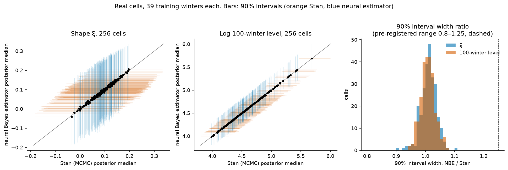
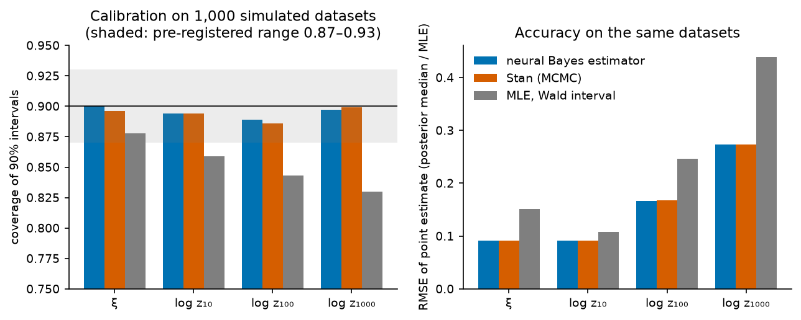
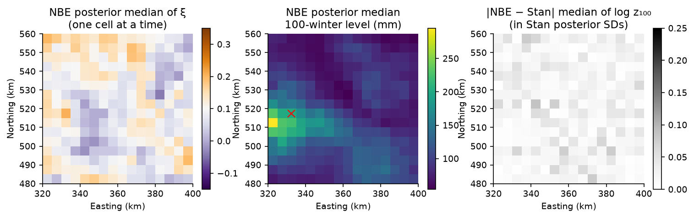

# Neural Bayes estimation of rare winter rainfall: matching MCMC in milliseconds

Can a neural network trained only on Monte Carlo simulations reproduce full Bayesian inference
for extreme rainfall? This repository trains a **neural Bayes estimator** (NBE) for the GEV
distribution of winter-maximum daily rainfall and tests it, against a pre-registered standard,
on 256 HadUK-Grid 5 km cells over Cumbria, using **Stan** (MCMC) as the reference, **JAGS** as a
cross-check of Stan and maximum likelihood as the classical baseline.

**Result.** With the same prior, the NBE reproduces Stan's posterior in every one of the 256
cells, gives calibrated credible intervals on simulated data with known truth, and is about
100,000 times faster once trained (2 ms for all cells against 217 s). Both Bayesian methods are
much more accurate than maximum likelihood for 100- and 1,000-winter levels, whose Wald
intervals undercover. All criteria and the analysis were committed in
[`PREREGISTRATION.md`](PREREGISTRATION.md) before the network was trained or any model was fitted.



## Results

### Real data: 256 cells, 39 training winters each

| Pre-registered criterion (≥ 90% of cells) | ξ | log 100-winter level |
|---|---|---|
| NBE median within 0.25 Stan posterior SDs of Stan's median | **256 / 256** (largest gap 0.12 SD) | **256 / 256** (largest gap 0.09 SD) |
| NBE / Stan 90% interval width in 0.8–1.25 | **256 / 256** (range 0.91–1.10) | **256 / 256** (range 0.95–1.07) |

The same holds for the 10- and 1,000-winter levels and for all three independently trained
networks (largest gap over seeds and targets: 0.15 SD). Every real cell lies inside the
distribution of simulated training inputs (out-of-distribution check: smallest tail probability
0.009 among 256 cells). Stan: 253 of 256 fits pass the convergence rule (R-hat < 1.01, bulk and
tail ESS > 400, no divergences); the other 3 have one divergent transition each and are kept.
JAGS on 16 cells agrees with Stan to within 0.006 in ξ and 0.8% in the 100-winter level.

### Simulation with known truth: 1,000 datasets drawn from the prior



| | Coverage of 90% intervals (± 0.01 MC SE) | | | RMSE of the point estimate | | |
|---|---|---|---|---|---|---|
| Target | **NBE** | Stan | MLE (Wald) | **NBE** | Stan | MLE |
| ξ | **0.900** | 0.896 | 0.878 | **0.091** | 0.091 | 0.151 |
| log z₁₀ | **0.894** | 0.894 | 0.859 | **0.092** | 0.092 | 0.107 |
| log z₁₀₀ | **0.889** | 0.886 | 0.843 | **0.167** | 0.167 | 0.247 |
| log z₁₀₀₀ | **0.897** | 0.899 | 0.830 | **0.274** | 0.273 | 0.439 |

The NBE meets the pre-registered calibration range (0.87–0.93) for every target. Its intervals
are as wide as Stan's (median width ratio 1.01) and its posterior medians correlate with Stan's
at 0.997–0.9998. Maximum likelihood uses no prior information, so with 39 maxima its estimate
of ξ is noisy, and its Wald intervals for rare levels cover only 83–84%.

### Held-out winters and Storm Desmond



* **25 held-out winters** (validation + test, 6,400 maxima; never used for estimation): the share
  of maxima above each method's posterior-median 10-winter level is 0.080 (NBE; 95% winter
  bootstrap 0.029–0.150), 0.081 (Stan), 0.091 (MLE) and 0.098 for the training winters' own
  empirical 90% quantiles. The NBE and Stan are indistinguishable (0.9-quantile score
  difference +0.001, 95% −0.001 to 0.003). Both sit slightly below 0.10 because a posterior
  median of the 10-winter level is not a predictive quantile; the interval includes 0.10.
* **Storm Desmond** (5 December 2015, a test winter; red × on the map) put 254.8 mm on a cell
  whose 39 training maxima peak at 163.3 mm. From that cell alone, Stan's posterior median return
  period is 308 winters (90% interval 76–4,176); the NBE's 1,000-winter level is 327 mm (90%
  219–555 mm; Stan 325 mm, 218–555 mm). One cell's 39 winters cannot pin down a tail this far
  out, which is the case for pooling information across cells.

### Cost

| | Time for 256 cells | One-off cost |
|---|---|---|
| Stan, 4 chains × 2,000 iterations | 217 s (2 cores) | – |
| NBE | 0.002 s (1 core) | training, 5–8 min per network |

## Method

* **Model and prior** (shared by every method): 39 i.i.d. winter maxima per cell from
  GEV(μ, σ, ξ), μ ~ U(10, 150) mm, σ ~ U(2, 50) mm, ξ + 0.5 ~ Beta(9, 6) (Martins & Stedinger
  2000). The bounds are physical, not fitted.
* **Estimator.** A multilayer perceptron (3 × 256) takes the 39 maxima sorted (order statistics
  are sufficient, so the estimator is permutation-invariant) and standardised by their mean and
  SD, plus the mean and log SD. It outputs five posterior quantiles (0.05–0.95) of μ, log σ, ξ
  and the 10-, 100- and 1,000-winter levels, as a median plus positive increments so quantiles
  cannot cross. It is trained with the pinball loss, whose minimiser is the posterior quantile
  (Sainsbury-Dale et al. 2024; Richards et al. 2024), on fresh prior simulations every epoch,
  with early stopping on a separate simulated validation set.
* **Reference.** Stan with the identical likelihood and prior; JAGS (zeros trick) for 16 cells.

### Rigour and leakage controls

| Risk | Control |
|---|---|
| Real data inform the estimator | The network is trained, validated and tuned on simulations only; no rainfall data are read in `python/train.py`. |
| Held-out winters inform an estimate | Every estimate uses a cell's 39 training winters; only `python/evaluate.py` reads the 25 validation and test winters. |
| Test-set reuse in simulation | The simulated test set has its own seed, distinct from the training and validation seeds. |
| Cells treated as independent | Held-out intervals bootstrap whole winters, never cells. |
| Moving the goalposts | Criteria fixed in `PREREGISTRATION.md` before training or fitting; two computational amendments (Stan starting values; refits of fits with divergent transitions) are recorded there with when they were made. |
| One lucky network | Three networks with different seeds; all meet every criterion. |

**Limitations.** Each cell is analysed alone: no pooling across cells and no spatial dependence.
The estimator is valid only inside its training prior and for exactly 39 maxima. The comparison
shows that the NBE matches the Bayesian answer for this model, not that the model is right; the
pilot repository addresses spatial structure.

## Relation to the pilot

The pilot [`rainfall-extremes-pilot`](https://github.com/RidhimaGupta4/rainfall-extremes-pilot)
builds generators of whole rainfall fields with extreme-value margins and uses the same data and
split. This repository supplies a fast, calibrated way to estimate those margins. The natural
next steps are an NBE for spatial dependence parameters, where likelihoods are intractable and
MCMC is impractical, and estimators trained over varying sample sizes and censoring, as in
peaks-over-threshold models.

## Reproduce

```bash
micromamba create -n nbe -c conda-forge python=3.12 "pytorch=*=cpu*" numpy pandas scipy matplotlib
# R with cmdstanr, posterior, rjags and JAGS for the MCMC reference
mkdir -p data/raw && curl -L -o data/raw/cumbria_winter_rainfall_5km.nc \
  https://github.com/RidhimaGupta4/rainfall-extremes-pilot/raw/main/data/cumbria_winter_rainfall_5km.nc
Rscript R/00_build_data.R
python tests/test_nbe.py
for s in 1 2 3; do python python/train.py $s; done       # 5-8 min each on 2 CPU cores
python python/make_sim_test.py
Rscript R/10_mcmc.R sim && Rscript R/10_mcmc.R real
Rscript R/10b_refit_flagged.R sim && Rscript R/10b_refit_flagged.R real
Rscript R/12_mle.R sim && Rscript R/12_mle.R real
Rscript R/13_export_draws.R
Rscript R/11_jags.R
python python/apply.py
python python/evaluate.py
python python/figures.py
```

Trained weights are in `models/`, so the training step can be skipped.

| Path | Contents |
|---|---|
| `PREREGISTRATION.md` | plan, criteria and amendments |
| `python/nbe.py` | GEV functions, prior, features, network, pinball loss |
| `python/train.py`, `python/apply.py` | training on simulations; applying to the test set and the cells |
| `python/evaluate.py`, `python/figures.py` | all evaluation (the only code that reads held-out winters); figures |
| `stan/gev_cell.stan`, `jags/gev_cell.jags` | the reference model in Stan and JAGS |
| `R/` | data build, MCMC, refits, MLE, JAGS check |
| `tests/test_nbe.py` | GEV functions against SciPy, prior, permutation invariance, non-crossing quantiles, pinball minimiser |
| `results/`, `figures/`, `models/` | outputs (posterior draws are regenerated, not committed) |

## Data and licence

HadUK-Grid v1.3.2.ceda (Met Office), via the pilot repository; contains public sector information
licensed under the Open Government Licence v3.0. Code: MIT (`LICENSE`).

## References

* Hollis, D., McCarthy, M., Kendon, M., Legg, T. and Simpson, I. (2019). HadUK-Grid—A new UK
  dataset of gridded climate observations. *Geoscience Data Journal*. doi:10.1002/gdj3.78
* Martins, E. S. and Stedinger, J. R. (2000). Generalized maximum-likelihood generalized
  extreme-value quantile estimators for hydrologic data. *Water Resources Research*, 36(3),
  737–744. doi:10.1029/1999WR900330
* Richards, J., Sainsbury-Dale, M., Zammit-Mangion, A. and Huser, R. (2024). Neural Bayes
  estimators for censored inference with peaks-over-threshold models. *Journal of Machine
  Learning Research*, 25(390), 1–49.
* Sainsbury-Dale, M., Zammit-Mangion, A. and Huser, R. (2024). Likelihood-free parameter
  estimation with neural Bayes estimators. *The American Statistician*, 78(1), 1–14.
  doi:10.1080/00031305.2023.2249522
